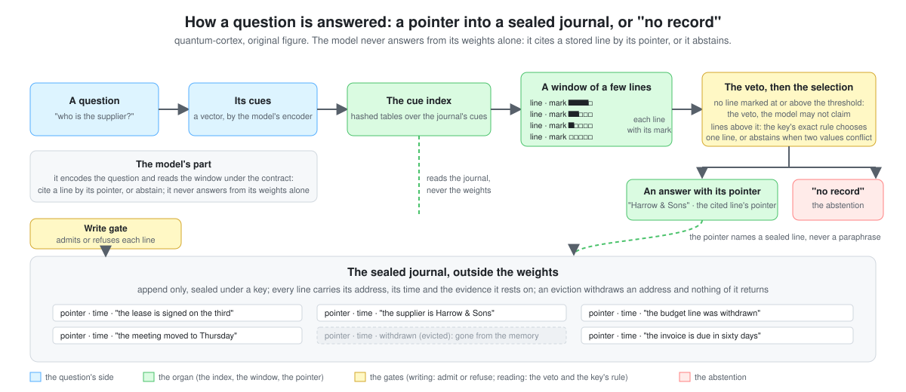
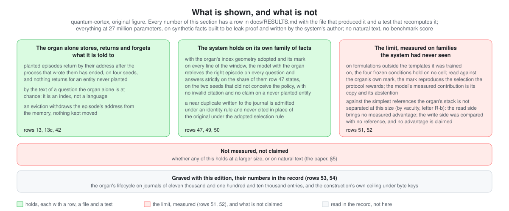
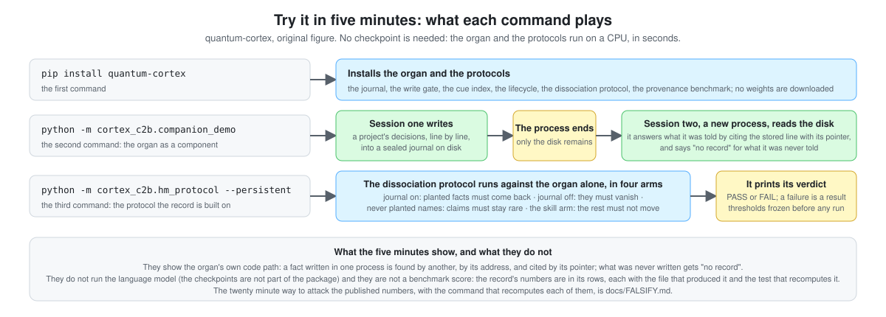
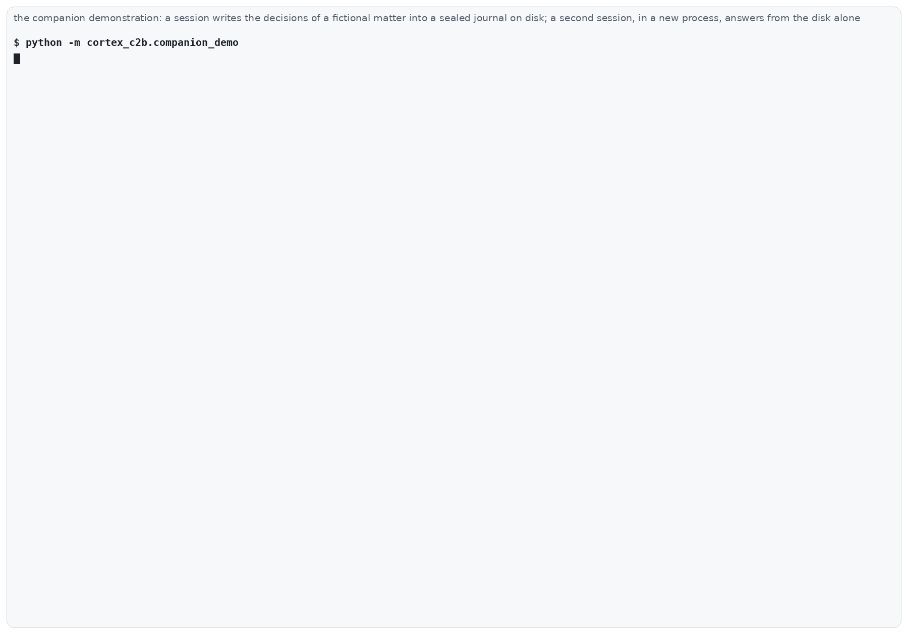
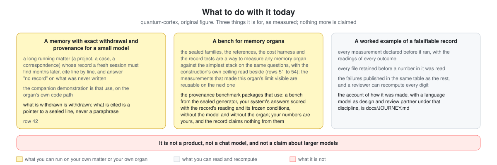

# quantum-cortex

[](https://doi.org/10.5281/zenodo.23110775) [](https://pypi.org/project/quantum-cortex/) [](https://github.com/vaneeckhoutnicolas/quantum-cortex/actions/workflows/ci.yml) [](LICENSE) [](LICENSE-DOCS.md)

**A small language model with a memory outside its weights: a sealed journal of episodes that the model must cite or abstain from, built so that every claim about it has a row, a file and a test that can fail.**

## What it is

quantum-cortex is a 27 million parameter byte level language model, trained from scratch by one researcher on a free GPU tier and a laptop, plus an *organ* that lives outside the weights: an append only journal of episodes, sealed under a key, each line carrying its address, its time and the evidence it rests on; a write gate that admits or refuses a line; an index that returns a small window of candidate lines for a question; a read path that hands the model that window with the organ's own similarity written on every line, and a veto that refuses a citation the organ marks weakly. The model reads the journal while it generates under one contract: cite the line it uses, by its pointer, or say it does not know. An episode the organ evicts is withdrawn from its memory of addresses; nothing is kept in the weights that the journal already holds. The name is the family's (Quantum Meridian, an orchestration project around existing models); nothing here is quantum computing.



A one page explanation of the organ for a reader who is not a specialist is [`docs/EXPLAINER.md`](docs/EXPLAINER.md).

## What is shown, and what is not

Every number below has a row in [`docs/RESULTS.md`](docs/RESULTS.md) with the file that produced it and a test that recomputes it. Everything is at 27 million parameters, on synthetic facts built to be leak proof and written by the system's author; nothing here is natural text, and nothing here is a benchmark score.

- **The organ alone stores, returns and forgets what it is told to.** Planted episodes return by their address after the process that wrote them has ended, on four seeds, and nothing returns for an entity that was never planted (row 13: planted 1.000, cut 0.125, never planted 0.000). By the text of a question the organ alone is at chance: it is an index, not a language (row 13c). An eviction withdraws the episode's address from the memory: 600 of 600 withdrawn addresses no longer return, nothing kept moved (row 42).
- **The system holds on its own family of facts.** With the organ's index geometry adopted and its mark on every line of the window, the model with the organ retrieves the right episode on 600 of 600 questions and answers strictly on 95 % and 91 % of them on the two seeds that did not conceive the policy, with no invalid citation and no claim on a never planted entity (row 47); a near duplicate written to the journal is admitted under an identity rule and never cited in place of the original under the adopted selection rule (rows 49, 50).
- **The limit, measured on families the system had never seen (rows 51, 52).** On formulations outside the templates it was trained on, the four frozen conditions hold on no cell (letter A3): the model's strict recall is 0 of 200 on every cell. Read against the organ's own mark, the model alone selects the right line on 5 reads where the mark alone selects it on 287, of 466 (the sentence declared for this outcome and graved: *on these formulations the organ's mark reproduces the selection the protocol rewards; the model's measured contribution is its copy and its abstention*). Against the simplest references, a byte level BM25 and an exhaustive cosine on the organ's own cues with an exact verifier, the organ's stack is not separated at this size: 0 against 0 on 400 pairs (letter R-b, by vacuity). The read side brings no measured advantage over a classical stack on these families; the write side (persistence, withdrawal, provenance) was compared with no reference and no advantage is claimed for it. The cost on one processor at 200 entries: the organ's index step 235 to 243 microseconds, BM25's 65 to 89, the exhaustive cosine's 512 to 524, against the encoder's 20 to 23 milliseconds per question (row 52; not a scale result).

Whether any of this holds at a larger size, or on natural text, is not measured and not claimed (`docs/WHITEPAPER.md`, §5). Rows 53 and 54, graved with this edition, read the organ's lifecycle on journals of eleven thousand and one hundred and ten thousand entries and the construction's own ceiling under byte keys; their numbers are in the record, not here.



## Try it in five minutes

```
pip install quantum-cortex
python -m cortex_c2b.companion_demo
python -m cortex_c2b.hm_protocol --persistent
```



The first command installs the organ and the protocols (no checkpoint is needed for what follows). The second runs the organ as a component: a session writes a project's decisions into a sealed journal on disk, a second session in a new process that knows nothing but the disk answers five questions by citing the stored line with its pointer and says "no record" for three it was never told, printing the scores it decided on (seconds on a CPU). The third runs the dissociation protocol the record is built on, against the organ alone, and prints its verdict. The twenty minute way to attack the published numbers, with the command that recomputes each of them from the committed files, is [`docs/FALSIFY.md`](docs/FALSIFY.md); the record tests run with `pytest tests/ -m "not slow"` on a clone (825 of the 842, in about fifteen minutes on one processor).



<details>
<summary><b>Use it with your own model, in a dozen lines</b> (the organ as a library, any model decoding, no training; the two blocks are run as printed by <code>tests/test_compose_snippet.py</code>)</summary>

Session A, today (the key comes from the environment, one per journal, never from a file):

<!-- compose: session A -->
```python
import os
from cortex_c2b import Journal, POLICY_STOP
from cortex_c2b.write_path import WritePath
from cortex_c2b.read_path import JournalPath
from cortex_c2b.hm_protocol import address_cue

key = bytes.fromhex(os.environ["QUANTUM_CORTEX_JOURNAL_KEY"])     # one key per journal, one journal per scope, never in a file
journal = Journal("runs/my-scope/journal.jsonl", key=key, policy=POLICY_STOP)
write, read = WritePath(journal, admission_threshold=0.15, seed=0), JournalPath(journal)
address = "decision|argument:originality"                          # the entity is the address
report = write.write(address_cue(address),
                     b"12 Jan: the originality argument is set aside on the strength of ruling 2024/AR/512",
                     "decision", now=0.0, source=address)          # the text of the address is sealed beside the record (ADR-009)
if report.admitted:                                                # the gate refuses what the journal already predicts
    read.on_write(report.entry)
print("written" if report.admitted else f"refused: {report.reason}", report.entry.pointer[:12] if report.entry else "")
```

Session B, months later, in a new process that knows nothing of session A but the disk:

<!-- compose: session B -->
```python
import os
from cortex_c2b import Journal, POLICY_STOP
from cortex_c2b.read_path import JournalPath
from cortex_c2b.hm_protocol import address_cue

key = bytes.fromhex(os.environ["QUANTUM_CORTEX_JOURNAL_KEY"])
journal = Journal("runs/my-scope/journal.jsonl", key=key, policy=POLICY_STOP)   # reopened from the disk alone
read = JournalPath(journal)
for address in ("decision|argument:originality", "decision|argument:database-right"):
    hits = read.retrieve(address_cue(address), k=4)                # never a scan; (entry, payload, score) per hit
    if hits and hits[0][2] >= 0.5:                                 # the declared line on the journal's own score
        entry, payload, score = hits[0]
        print("cite", entry.pointer[:12], payload.decode())        # the window your model answers from, under the contract
    else:
        print("abstain: no record for", address)
```

Expected: the first address is cited with its pointer and its record, the second is abstained on (no record was written); running session A again is refused as redundant; the files under `runs/my-scope/` are sealed (no plaintext at rest). `tests/test_compose_snippet.py` runs these two blocks as they stand, session B in a new process, and asserts all four. The line at 0.5 is declared for this cue convention; with your own encoder, set it on addresses never written before use, as the companion demonstration does. The three ways to compose the organ with a model, with what each inherits from the record and what it has to measure for itself, are in [`docs/README-LONG.md`](docs/README-LONG.md) and the paper's §3.6.

</details>

## What to do with it today

Three things it is for, as measured; nothing more is claimed.

- **A memory with exact withdrawal and provenance for a small model.** A long running matter (a project, a case, a correspondence) whose record a fresh session must find months later, cite line by line, and answer "no record" on what was never written: the companion demonstration above is that use, on the organ's own code path. What is withdrawn is withdrawn (row 42); what is cited is a pointer to a sealed line, never a paraphrase.
- **A bench for memory organs.** The sealed families, the references (BM25, the exhaustive cosine, an exact verifier), the cost harness and the record tests are a way to measure any memory organ against the simplest stack on the same questions, with the construction's own ceiling read beside (rows 51 to 54): the measurements that made this organ's limit visible are reusable on the next one. The provenance benchmark ([`docs/PROVENANCE-BENCH.md`](docs/PROVENANCE-BENCH.md)) packages that use: it builds a bench from the sealed generator, your system reads the statements and answers the questions, and it scores the answers with the record's reading and the record's frozen conditions, without the model and without the organ; your numbers are yours, and the record claims nothing from them.
- **A worked example of a falsifiable record.** Every measurement was declared before it ran, with the readings of every outcome; every file was retained before a number in it was read; the failures are published in the same table as the rest, and a reviewer can recompute every digit. The account of how it was made, with a language model as design and review partner under that discipline, is [`docs/JOURNEY.md`](docs/JOURNEY.md).

It is not a product, not a chat model, and not a claim about larger models.



## Where to go next, by question

The paper carries the detailed taxonomy; this screen only names where each question is answered.

- *What is the capability called continuity, and who is it for?* The paper's §1.2 (its three components) and §1.4 (the five settings, and what the results serve today, §1.4b).
- *How is the organ built, rule by rule?* §3.5 (the write path as a ledger: five rules and their origin), §3.6 (the organ composed with other models); the decisions behind them, [ADR-007](docs/adr/ADR-007-c2b-persistent-tier.md) (the persistent tier, the lifecycle, the write gate) and [ADR-008](docs/adr/ADR-008-journal-in-the-decode-loop.md) (the journal in the decode loop, the cite or abstain contract).
- *How are the measurements read, and what do the letters mean?* §2.6 (the admission of claims), §4.2 (why a map and not a ranking), §4.8 (the ideas, one by one, with what each measurement validated or invalidated); the letters of the independent test are declared in [ADR-010](docs/adr/ADR-010-independent-test-industrial-door-2026-10-14.md), part A, before any number.
- *What happens under attack?* §4.9 (security in two registers, by design and by measure).
- *How does the organ compare with the simplest alternatives?* §4.10 and [ADR-010](docs/adr/ADR-010-independent-test-industrial-door-2026-10-14.md), parts B and C (the references, the cost, the scale probe with the cascade).
- *What maps to the brain and what does not?* §5c; the feature map, [ADR-003](docs/adr/ADR-003-brain-feature-map.md).
- *What are the limits?* §6 (the reserves), §5d (what waits for a larger size).
- *How do I reproduce or attack it?* §7 and [`docs/FALSIFY.md`](docs/FALSIFY.md); every file, [`metrics/ARTEFACTS.md`](metrics/ARTEFACTS.md); the evidence inventory, Appendix A.
- *The words.* [`docs/glossary.md`](docs/glossary.md); the decision index, [`docs/adr/README.md`](docs/adr/README.md).

## Read the record

The paper, [`docs/WHITEPAPER.md`](docs/WHITEPAPER.md); the record, one row per claim or non claim, [`docs/RESULTS.md`](docs/RESULTS.md); the decisions and their amendments, [`docs/adr/`](docs/adr/); how to attack it, [`docs/FALSIFY.md`](docs/FALSIFY.md); where every file lives, [`metrics/ARTEFACTS.md`](metrics/ARTEFACTS.md); the long README of the first edition, [`docs/README-LONG.md`](docs/README-LONG.md). Code under Apache 2.0 (the `NOTICE` file travels with every copy), documentation under CC BY 4.0; cite with `CITATION.cff` (the concept DOI 10.5281/zenodo.23110775 resolves to the latest archived edition).

*Author: Nicolas Van Eeckhout (Win2Win SRL, Brussels).*
