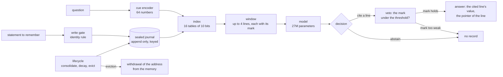

# The organ, in one page

## The question

A language model is asked to be one system: to know, to recall and to judge, all from the same weights. When it is wrong about your project, nothing tells you whether it never knew, forgot, or made it up; when you want it to forget, you cannot. This project separates the three. The weights keep what the model has learned to do; a memory outside the weights keeps what it has been told; and the model's job in between is reduced to one decision it can be held to: cite the line it rests on, or say it does not know.

## The parts

- **The journal.** An append only file of lines, each sealed under a key the model never sees: a line holds the episode's bytes, its time, a pointer (a 64 bit hash of its content) and the pointer of the source text it rests on. A line is never edited; the same text with a new content is written as a new version at the same address, with its history kept (row 43). The journal is the only place an episode lives.
- **The write gate.** Every statement goes through a gate before it is written. The rule adopted in this edition is the identity rule: a statement whose source text the journal does not hold is admitted whatever its resemblance to a stored line; the same text again is redundant, and the same text with another content becomes a version. A near duplicate (the same entity with another value, or a name one character away) is therefore admitted and its nearest stored line is recorded beside it, so that nothing is silently lost and a conflict is visible at read time, where the system abstains when two values of one entity are in its window (rows 48 to 50; which value holds is the version question, open for the next edition).
- **The cue and the index.** Each statement and each question is turned into a cue, a vector of 64 numbers, by the model's own encoder. The index hashes a cue into 16 tables of 10 bits and returns the candidate lines that share a bucket; the window is the best four of them by cosine. The index is the organ's geometry, chosen on its own measurements and adopted when they held on seeds that had not chosen it (rows 45, 47).
- **The mark and the veto.** Each line of the window is handed to the model with the organ's own similarity to the question written on it, the mark. The model decides: cite one line and read its value, or abstain. If it cites a line whose mark is under a threshold read once on the training family, the organ vetoes the citation and the answer is "no record". If the mark holds, the organ answers with the cited line's own value where the line's text parses under the known templates, never with the model's paraphrase; on a line it cannot parse, the system abstains.
- **The lifecycle.** Every sixteen writes a phase fires: the most salient live lines are consolidated into a persistent memory of addresses, consolidated lines decay, a line under a floor is evicted, and an eviction withdraws the line's address from that memory: afterwards the address is not reconstructible from what is kept (row 42; the cascade on journals of eleven thousand entries, row 53).

## The contract, in one sentence

An answer is either a pointer to a sealed line with that line's value, or "no record"; a claim about an entity the journal never held is a counted failure, not a style.

## What the measurements say, in four lines

The organ alone keeps, returns and forgets as declared, on four seeds, in a new process from the disk alone (rows 13, 42). The model with the organ holds the contract on the family of facts it was trained to read: the right line retrieved on 600 of 600 questions, strict answers on 95 % and 91 % on the two seeds that did not conceive the policy, no invented citation (row 47). On families of formulations it had never seen, the model's own reading fails on every cell while the organ's mark alone selects the right line (5 against 287 reads of 466), and against the simplest classical references on the same questions the organ's stack is not separated at 200 entries (rows 51, 52): the read side brings no measured advantage yet; the write side's properties (persistence, withdrawal, provenance) are measured against no reference and claimed against none. On journals of eleven thousand and one hundred and ten thousand entries, read without the model, the organ's withdrawal holds on every phase of thirty one lifecycle runs, and the mark's guarantee against never planted names is measured to end at those sizes: a never planted name finds a stored line marked at or above the threshold on 4 501, 4 730 and 4 968 of 5 000 at eleven thousand entries and on 1 000 of 1 000 at one hundred and ten thousand (row 53, under its label). Everything is at 27 million parameters, on synthetic facts; nothing is claimed beyond that.

## What it is not

Not a chat model, not a product, not a retrieval augmented generation pipeline with a vector database behind it (the index is sixteen tables of bits on the model's own cues, the journal is sealed and append only, and the model is trained to read the window), and not a claim that any of this holds at a larger size or on natural text. It is a small system built so that each of those claims, when someone makes it, has a row to be measured in.

## Where the record is

[`RESULTS.md`](RESULTS.md) (one row per claim or non claim, with its file and its test), [`WHITEPAPER.md`](WHITEPAPER.md) (the paper), [`adr/`](adr/) (the decisions, declared before the numbers), [`FALSIFY.md`](FALSIFY.md) (how to attack each number), [`../metrics/ARTEFACTS.md`](../metrics/ARTEFACTS.md) (where every file lives); the first screen of the repository is the root [`README.md`](../README.md).

*Written 2026-11-03 beside the first screen's draft, validated by the author on 2026-11-05 and placed here at v1.1.0, with one sentence on row 53 added that day; every mechanism named is the frozen system's (`../metrics/mqar/FREEZE-v1.1.0.json`), every number a row's.*
