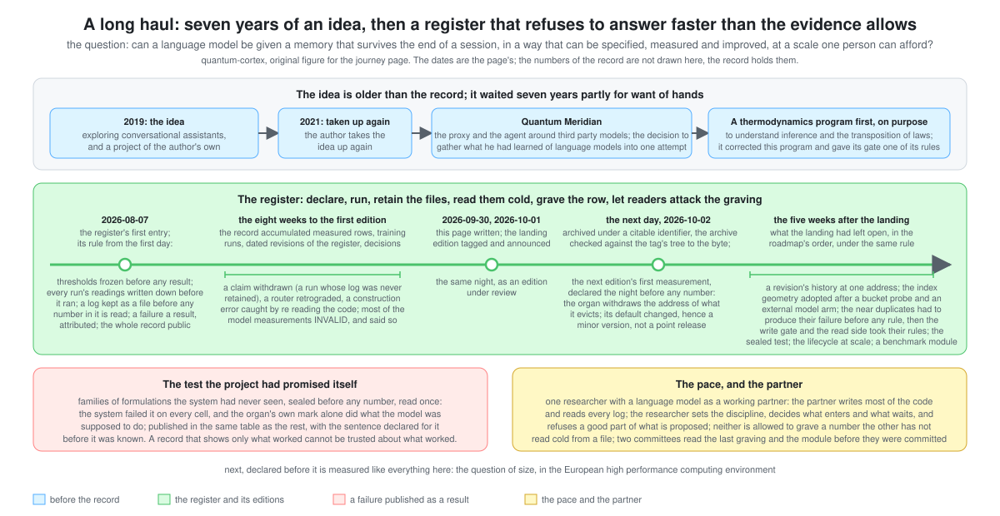
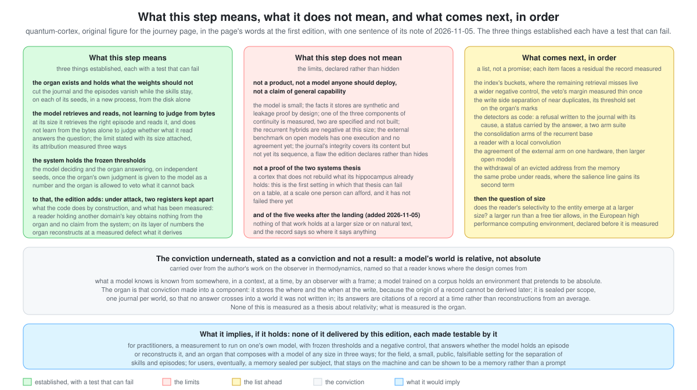

# A long haul: what this step means, what it does not, and what comes next

*This page is not part of the whitepaper and claims nothing the record does not. It exists so that a reader understands the approach before the numbers, and the implications after them. Written 2026-09-30, at the first edition.*

## What this project is doing, and at what pace

quantum-cortex asks one question and refuses to answer it faster than the evidence allows: can a language model be given a memory that survives the end of a session, in a way that can be specified, measured and improved, at a scale one person can afford? The question is old. What is new here is the discipline around it: thresholds frozen before any result existed, the readings of every run written down before it ran, a log kept as a file before any number in it is read, a failure treated as a result and attributed before the next attempt, and the whole record public, including the runs that did not work.

The idea is older than the record. It dates from 2019, when the author was exploring conversational assistants with Rasa and Botpress and a project of his own, Grizzly Crunch; he took it up again in 2021; and it was while building Quantum Meridian, the proxy and the agent around third party models, that he decided to gather everything he had learned about language models into one attempt at a different approach. He began that attempt with a research program in thermodynamics, on purpose, to understand inference and the transposition of one discipline's laws into another before writing a line of the model; that program corrected this one more than once and gave it rule 6 of its gate. Seven years of an idea, then, and eight weeks of a register: the first entry of the register dates from 2026-08-07, and in the time since, the record accumulated forty two measured rows (forty four with 10b and 13b), twelve training runs, about forty six GPU hours on a free tier and a laptop, ninety six dated revisions of the register and nine architecture decisions. Most of the model measurements in it are INVALID and say so in the same table as the rest. That is not a confession; it is the point. A record that shows only what worked cannot be trusted about what worked.

The pace is the pace of one researcher with a language model as a working partner. The partner writes most of the code and reads every log; the researcher sets the discipline, decides what enters and what waits, and refuses a good part of what is proposed. Neither could have produced this record alone at this speed, and neither is allowed to grave a number the other has not read cold from a file.

*Figure added 2026-11-05 (original, `docs/figures/journey-timeline.svg`): the question the project asks, then the journey as this page tells it, from the idea of 2019 to the five weeks after the landing, at the page's dates; the register's rule in one line; the sealed test told as the page tells it; the pace and the partner. The numbers of the record are not drawn; the text is as written on its dates.*

## Why with a language model, and why in the open

Two things about the approach are the author's choices, and he asks that they be said as such.

The first is the partner. The idea waited seven years partly for want of hands: one person cannot write, run, read and doubt at the pace this record shows, and a research program in thermodynamics on the side does not shorten the day. What changed is not the idea but the means. The technology of the last few years, artificial intelligence first among it, is what let the author carry his research further than his own time allowed: a language model that writes the code, reads every log and drafts the declarations, under a discipline it did not set. The relation that resulted is, in his words, a symbiosis rather than the use of a tool: each side supplies what the other lacks, the researcher the direction, the discipline and the refusals, the model the generation and the execution, and the record is what the two produce together and neither would produce alone. The gate of the whitepaper is what keeps that relation honest; the withdrawn claim and the corrected errors are what it looks like when it works. The organ this repository builds is, not by accident, the one the partner lacks (whitepaper §5b).

The second is the openness. The author's aim has been, from the start, to contribute to something larger than his own ecosystem and his own ego; an open repository was the natural form of that aim, not a strategy. Ideas live when others take them up, test them, break them and build on them, and the record is public, negative rows included, in the hope of exactly those contributions: a replication on another machine, a row on another model, a door taken by a laboratory with the compute, a correction. The licences (Apache 2.0 for the code, CC BY 4.0 for the text) ask one thing in return, that the authorship travel with the work; everything else is given.

## Why the humility is structural, not a tone

Research on memory in language models is full of results that do not survive a second seed, a real task or a re reading. This project has withdrawn one claim already (a five seed run whose log was never retained), retrograded another (a router that reached 93 % of its ceiling on a synthetic task and 25 % on real spans), caught a construction error by re reading its own code, and settled a disagreement between two AI instances by going back to the source. Each of these is in the register with its date. The seven rule gate of the whitepaper exists because of them.

So when this edition says that something holds, it says on how many seeds, against which frozen threshold, with which reserve written next to it. When it says that something does not hold, it says why, as precisely as the measurements allow, and what would have to be true for it to hold later. The reader who wants to attack the work has a twenty minute page for it (`docs/FALSIFY.md`). Humility here is not a posture; it is what is left when every claim has to survive that page.

## The conviction underneath, stated as a conviction

One idea sits under the whole program and is not a result of it; the author asks that it be named, so that a reader knows where the design comes from. It is that a model's world is relative, not absolute. What a model knows is known from somewhere: in a context, at a time, by an observer with a frame; and the same statement, the same action, does not carry the same meaning or the same consequences in another context. A model trained on a corpus holds an environment that pretends to be absolute, the average of everything it read. The author's conviction, carried over from his work on the observer in thermodynamics (whitepaper §2.7 and §5d, door 7), is that intelligence in use is the opposite: relative to the world around it and to the context it is in.

The organ is that conviction made into a component. It stores the where and the when at the write, because the origin of a record cannot be derived later (§3.5, rule 1); it is sealed per scope, one journal per world, so that no answer crosses into a world it was not written in (§4.9); and its answers are citations of a record at a time rather than reconstructions from an average. The door the paper names and does not open, that the same action has other consequences in another world, is the same conviction one step further (the register's world model door). None of this is measured as a thesis about relativity; what is measured is the organ. The conviction is stated here so that the design is legible, and so that a reader who does not share it knows what to attack.

## What this step means

Three things are established at this edition, each with a test that can fail.

The organ exists and holds what the weights should not: cut the journal and the episodes vanish while the skills stay, on four seeds, in a new process, from the disk alone. The model, at 27 million parameters, retrieves the right episode and reads it, and does not learn from the bytes alone to judge whether what it read answers the question; that limit is stated with its size attached and its attribution measured three ways. And the system, the model deciding and the organ answering, holds the four frozen thresholds on two independent seeds once the organ's own judgment is given to the model as a number and the organ is allowed to veto what it cannot back.

To that, the edition adds what the organ guarantees under attack, in two registers kept apart: what the code does by construction, and what has been measured. A reader holding another domain's key obtains nothing from the organ, by construction, and no claim from the system, on three seeds and six hundred queries; the margin by which that zero holds is written next to it, because it is thin on one seed. And, on its layer of numbers, the organ reconstructs at a measured defect what it derives: the salience line to a millionth, every replayed address under its bound, on three journals and forty phases of sleep without a read; the same probe shows that an evicted episode leaves its address in the memory, a finding the next edition takes up.

## What this step does not mean

This is not a product, not a model anyone should deploy, and not a claim of general capability. The model is small; the facts it stores are synthetic and leakage proof by design; one of the three components of continuity is measured, two are specified and not built; the recurrent hybrids are negative at this size; the external benchmark on open models has one execution and no agreement yet; and the journal's integrity covers its content but not yet its sequence, a flaw the edition declares rather than hides.

It is also not a proof that the two systems thesis, a cortex that does not rebuild what its hippocampus already holds, is right. It is the first setting in which that thesis can fail on a table, at a scale one person can afford, and it has not failed there yet.

## What comes next, in order

The next edition (v1.1) is a list, not a promise, and each item faces a residual this record measured. The index's buckets, where the remaining retrieval misses live. A wider negative control, because the veto's margin rests on fifty entities per seed and was measured thin once. The write side separation of near duplicates, with its threshold set on the organ's marks. The detectors as code: a refusal written to the journal with its cause, a status carried by the answer, a two arm suite that freezes their false positive rate. The consolidation arms of the recurrent base, the one measurement that could make the trunk carry the regime. A reader with a local convolution. The agreement of the external arm on one hardware, then larger open models. The withdrawal of an evicted address from the memory, which the reconstruction probe of this edition found still there. And the same probe under reads, where the salience line gains its second term.

Beyond that, the question that decides the model arm's future is a matter of size and needs a larger run than a free tier allows: does the reader's selectivity to the entity emerge at 150 million, 300 million or a billion parameters? That run is the declared next step, in the European high performance computing environment, and it will be declared before it is measured, like everything here.

## What it implies, if it holds

For practitioners: a measurement you can run on your own model today, with frozen thresholds and a negative control, that answers whether the model holds an episode or reconstructs it; and an organ that composes with a model of any size in three ways, as a library, behind a frozen prompt, or in the decode loop, each stated with what is measured and what is not (whitepaper §3.6). For the field: a small, public, falsifiable setting for the separation of skills and episodes, with a record that can be audited to the digit. For users, eventually: a memory that is sealed per subject, stays on the machine, and can be shown to be a memory rather than a prompt. None of these is delivered by this edition; each is made testable by it.

*Figure added 2026-11-05 (original, `docs/figures/journey-this-step.svg`): what this step means, what it does not mean and what comes next, in the page's words at the first edition, with one sentence of the page's note of 2026-11-05 dated as such; the conviction underneath and what it would imply if it holds. No number of the record is drawn in it; the text is as written on its dates.*

## After the landing (added 2026-10-03)

The landing edition was tagged on 2026-10-01 and announced the same night, as an edition under review. The next day it was archived under a citable identifier (Zenodo, mirrored by Software Heritage, the archive checked against the tag's tree to the byte), and the first measurement of v1.1, declared the night before any number existed, was run on the same three sealed journals and read cold from its files: the organ now withdraws the address of what it evicts, the control reproduces the previous row number for number, and nothing the organ kept moved (row 42). The organ's default changed with that row, which is why the next edition is a minor version and not a point release; the review's corrections travel with it.

## Before the second edition (added 2026-11-05)

The five weeks after the landing were spent on what the landing had left open, in the order the roadmap had fixed and under the same rule: declare, run, retain the files, read them cold, grave the row, let a committee of readers attack the graving before it is committed. The organ learned to withdraw what it evicts (row 42) and to keep a revision's history at one address (row 43); its index geometry was adopted after a bucket probe and an external model arm (rows 44 to 47); the near duplicates at the write gate had to produce their failure before any rule was written (row 48), and the write gate and the read side selection then took their rules (rows 49 and 50). Then the test the project had promised itself: families of formulations the system had never seen, sealed before any number, read once. The system failed it on every cell, and the organ's own mark alone did what the model was supposed to do (rows 51 and 52). That result is published in the same table as the rest, with the sentence declared for it before it was known. The organ's lifecycle was then run on journals fifty five and five hundred and fifty times the protocol's, read without the model: the withdrawal held on every phase, and the guarantee the organ's mark gives against names it never held was measured to end at those sizes (row 53); the construction's own ceiling was read with an instrument built for it (row 54). A benchmark module packages the record's reading for anyone's memory system. Two committees of three readers each read the last graving and the module before they were committed; what they found is in the record, with what changed. Nothing of this holds at a larger size or on natural text, and the record says so where it says anything.

## How to read the record

Start with the README, then `docs/NAVIGATION.md` for the labels, then `docs/RESULTS.md` for any number, then the whitepaper. Everything else is method, and it is public because the method is one of the contributions.
